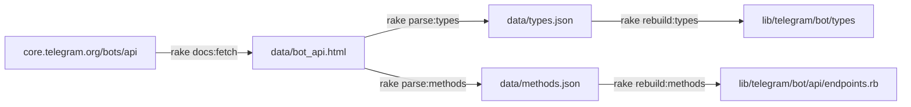
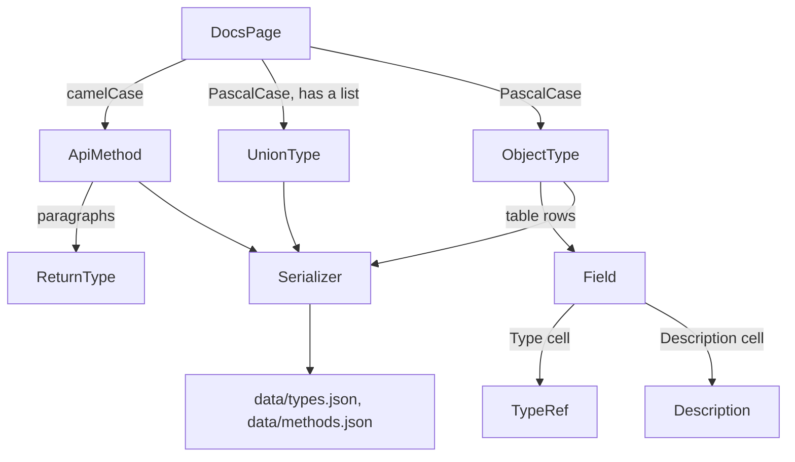

# Bot API docs parser

The types in `lib/telegram/bot/types` and the endpoint list in `lib/telegram/bot/api/endpoints.rb` are generated from the [Telegram Bot API documentation](https://core.telegram.org/bots/api). This document explains how the documentation is turned into the data that the code is generated from.

To update the gem to a new Bot API version, follow the [Maintenance section](../README.md#maintenance) of the main README. Come back here if parsing fails.

## Pipeline



- `docs:fetch` is the only step that uses the network. It saves the content of the page, without the site header and footer, to `data/bot_api.html`.
- `parse:*` reads only that snapshot, so parsing is reproducible and works offline.
- `rebuild:*` reads only the JSON files. It is implemented in `rakelib/builders` and is not covered here. The JSON format is the contract between the two halves.

The snapshot is committed. The parser specs read the same file, and one of them checks that parsing it produces exactly `data/types.json` and `data/methods.json`. If the snapshot, the parser, or the JSON files change without the others, the specs fail.

## How the page is read

The page is a flat list of elements. Every type and every method is an `<h4>` heading followed by paragraphs and, usually, a table:

```html
<h4>User</h4>
<p>This object represents a Telegram user or bot.</p>
<table>…</table>
<h4>Chat</h4>
<p>…</p>
<table>…</table>
```

No element contains "the `User` type". The parser therefore walks the page once and cuts it into entries: a heading plus the blocks up to the next heading. Each entry is then identified by the first rule it matches in `DocsPage`:

```ruby
GRAMMAR = EntryGrammar.new('h4') do
  entry ApiMethod, named: /\A[a-z][A-Za-z0-9]*\z/
  entry UnionType, named: TypeRef::NAME, with: 'ul'
  entry ObjectType, named: TypeRef::NAME
  skip named: /\s/
end
```

Names carry most of the decision, because an entry made of paragraphs alone can be a method without parameters (`getMe`), an object without fields (`ForumTopicClosed`) or prose ("Sending files"). A heading that matches no rule raises.

From an entry down, the page is described with page objects: one class per thing on the page, each declaring the markup it expects. When the page changes, the class to fix is the one named after the thing that changed. The classes are in `rakelib/parsers`, one per file.



What the diagram does not show:

- An `ObjectType` without a table is valid: the object holds no information.
- A `UnionType` lists the types it can be one of, as `MessageOrigin` does.
- An `ApiMethod` has a name and a return type. Parameters are not parsed.
- `Description` and `ReturnType` read prose, because the documentation states constraints and return types only in sentences such as "Defaults to 25" or "Returns *True* on success". They are lists of patterns, and they are where a reworded page breaks the parser first.
- `Serializer` is the only class that knows the format of the JSON files.

### Page objects

There are two kinds. An entry (`Entry`) is a heading and its blocks, and declares which blocks it reads by tag. Everything inside a block is real nested HTML, so the other page objects (`PageObject`) wrap one node and use CSS selectors or cell positions:

```ruby
class ApiMethod < Entry
  blocks :paragraphs, 'p'
  block :table, 'table', as: Table
end

class Table < PageObject
  texts :headers, 'th'
  elements :rows, '> tbody > tr'
end

class Field < PageObject
  cell :name, 0
  cell :description, 2, as: Description
end
```

The macros are defined in `entry.rb` and `page_object.rb`, and the mechanism behind the entry rules in `entry_grammar.rb`. Both kinds can define `validate!`, which runs when the object is created. An entry checks its shape there, down to the cells of its table, so a page whose entries can be listed has been read in full.

## When the page changes

Wherever the page has structure, the parser checks it and raises `Parsers::Error` instead of guessing: the output becomes committed code, so a wrong guess would ship a wrong type. The message starts with the name of the type or method; find it in `data/bot_api.html` to see what changed.

| Message | Where to fix it |
| --- | --- |
| `cannot find the return type` | `return_type.rb`: the return sentence is worded in a new way. |
| `Unsupported type` | `type_ref.rb`: a type cell is not a name, an `Array of`, or an `or` of names. |
| `Unrecognised heading` | `docs_page.rb`: a heading fits none of the entry rules. |
| Anything else | `object_type.rb`, `union_type.rb`, `api_method.rb` or `field.rb`: the layout of an entry or a table changed. |

Two things are not checked and fail silently:

- A constraint that is worded in a new way is not recognised by `Description`, and the field is generated without it.
- A prose heading that is a single word would be read as a method or as an object without fields.

The way to catch both is to read the diff of the JSON files against the Bot API changelog.

A new kind of constraint, as opposed to a new wording of an existing one, also needs a new key in `Serializer` and support for it in `rakelib/builders`.
